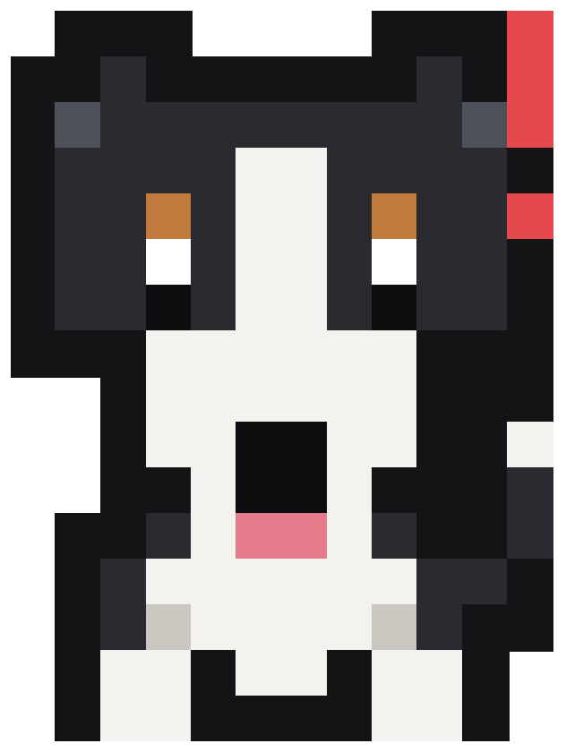
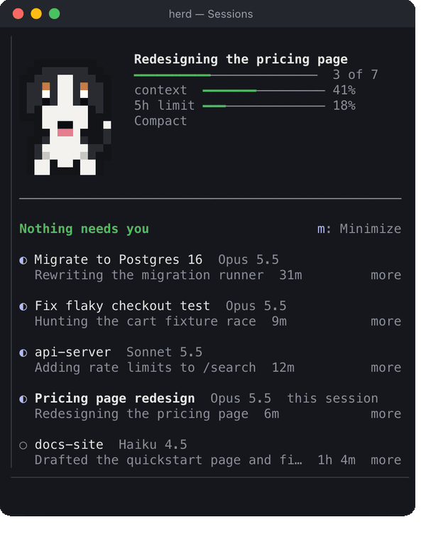
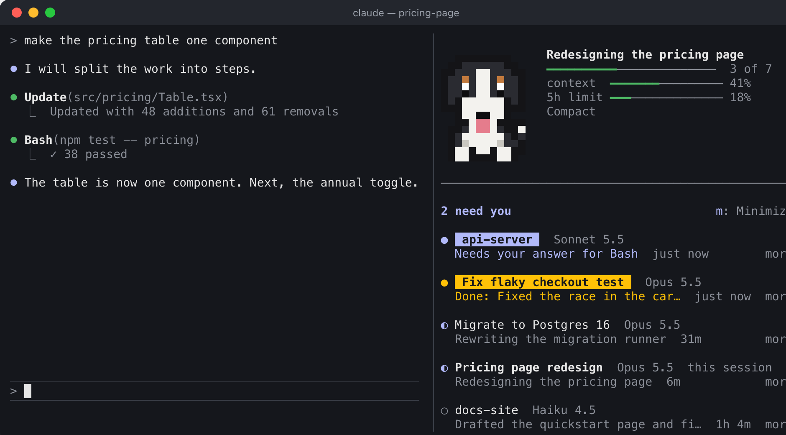
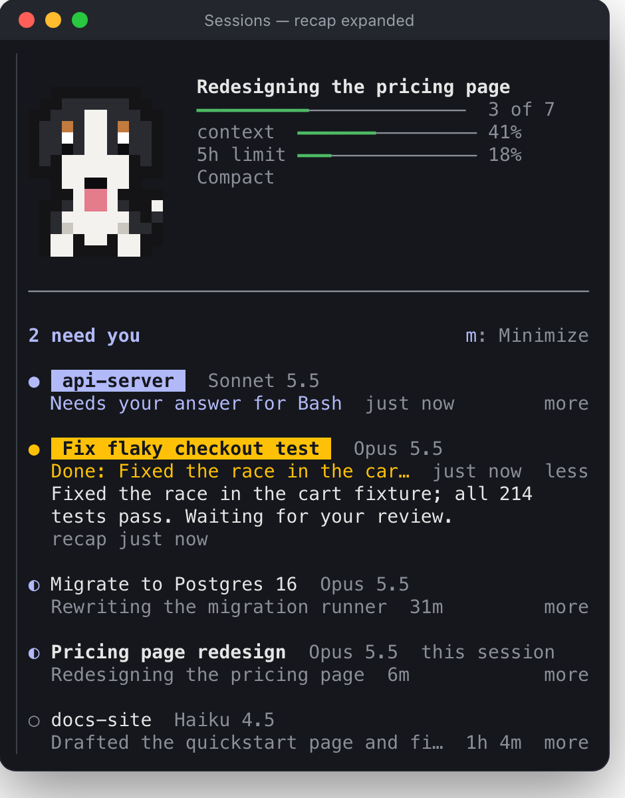
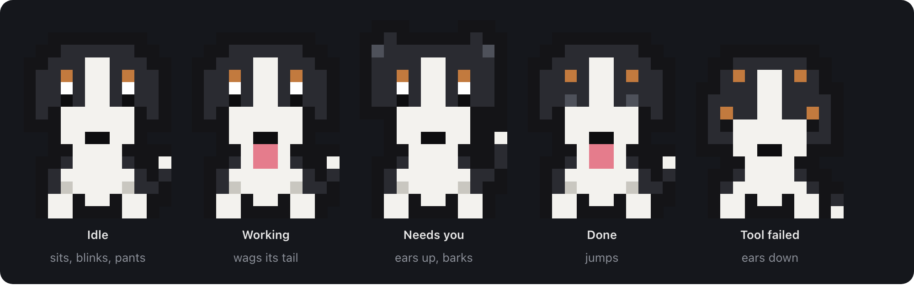
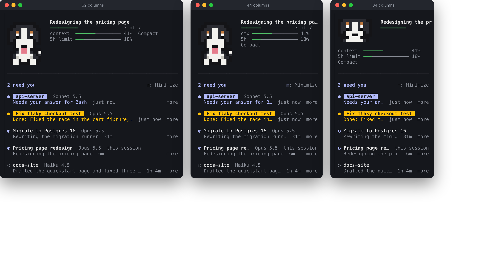

<div align="center">



# herd

**A pixel border collie that herds your Claude Code sessions.**<br>
It barks when one needs you, so none of them sit there waiting while you're three tabs away.

[](https://docs.anthropic.com/en/docs/claude-code)


[Install](#install) · [What it does](#what-it-does) · [Commands](#commands) · [Settings](#settings) · [How it works](#how-it-works) · [FAQ](#faq)



</div>

---

You opened one Claude Code session. Then another. Now there are eleven, and one of them has been politely waiting for a "yes" since lunch.

**herd** adds a side panel to every session. It lists the whole flock, tells you which ones need you, says what each one is doing, and takes you there in one click. A small dog sits on top and keeps an eye on things.

<p align="center"></p>

## Install

At the prompt of any Claude Code session:

```
/plugin install herd --marketplace ZobelOmry/claude-session-herd
```

Answer `y` to add the marketplace, pick a scope (user scope gives every new session the panel), and that's it. The panel opens on its own when the terminal is wide enough. Type `/sessions` to open it any time.

> **Works best on macOS with iTerm2.** The list, recaps, meters and the dog work in any terminal. Jumping to a tab and knowing whether you've seen a reply use iTerm2's AppleScript, so they are iTerm2-only.

## What it does

### Shows who needs you

Two kinds of "needs you", sorted to the top, longest wait first:

- **A permission dialog**  — the session can't move until you answer.
- **A finished turn you haven't seen**  — the reply landed while its tab was in the background. It clears the moment you bring that tab to the front, or type in it.

Each new one also pops a toast, so you hear about it even with the panel minimized.

### Says what each session is doing

Every row carries a one-line recap. Press **more** for the full story, **less** to fold it back.

<p align="center"></p>

The recap is the newest of two sources:

- Claude Code's own recap, the one it writes when you come back to a session after a while.
- A fresh one herd asks **Haiku** for after a turn ends, at most once every 5 minutes per session. ([You can turn this off.](#settings))

### Takes you there

Click any row and its iTerm2 tab jumps to the front, window and all.

### Keeps the vitals in view

For the session you're in: the current task, plan progress (`3 of 7`), context and 5-hour-limit meters that turn amber then red as they fill, and a **Compact** button that lights up when the context is getting full. Every row shows the model it runs on.

### Comes with a good dog

The dog acts out what the session you're in is doing:

<p align="center"></p>

Type `/pet-demo` to watch all five. Type `/pet` if you'd rather work alone.

### Fits whatever width you give it

<p align="center"></p>

Wide: the whole dog sits beside the meters. Narrower: labels shorten to `ctx` / `5h`. Narrow: just the head, meters underneath. Long names and recaps are cut with `…` instead of wrapping.

## Commands

| Command | What it does |
|---|---|
| `/sessions` | Open or close the panel (it remembers if you closed it) |
| `/pet` | Send the dog for a walk, or bring it back |
| `/pet-demo` | Play every one of the dog's reactions, 3 seconds each |
| `m` | With the panel focused: show only the sessions that need you |

## Settings

| Option | Default | What it does |
|---|---|---|
| **Fresh recaps** | on | After a turn ends, ask Haiku for a one-line recap (at most one per session every 5 minutes). Off: herd makes no model calls at all, and rows show only Claude Code's own recaps. |

Change it in `/config`, where it shows as a row of its own.

## How it works

```
 every session                         every other session
┌──────────────────────┐   3 s    ┌──────────────────────┐
│ herd writes a small  │ ───────▶ │ ~/.claude/herd/      │ ───▶ the panel reads them all,
│ snapshot: state,     │          │   sessions/<id>.json │      sorts, and draws the rows
│ title, recap, model  │          └──────────────────────┘
└──────────────────────┘
```

- **No server, no daemon.** Each session writes one JSON file every 3 seconds and reads the others'. A session that stops writing for 15 seconds drops off the list.
- **Titles and Claude Code's recaps** come from the session's own transcript.
- **"Have you seen it?"** is one `osascript` call that asks iTerm2 whether that tab is in front. It only runs while a reply is waiting. If macOS denies the permission, herd assumes you've seen it rather than nagging you about every turn.
- **The jump** is another `osascript` call that selects the tab by its iTerm2 session id. Only a validated id goes into it.
- **Nothing leaves your machine** except the optional Haiku recap, which goes through Claude Code's own API client like any other request.

## FAQ

**Does it cost tokens?**
Only the fresh recaps: one small Haiku call per session, at most every 5 minutes, on the last prompt and reply (a few thousand tokens). Turn **Fresh recaps** off and herd costs nothing.

**I use Terminal.app / Ghostty / tmux / VS Code.**
The panel, the recaps, the meters and the dog all work. Clicking a row shows a toast instead of jumping, and a finished turn never counts as unseen. Pull requests for other terminals are very welcome.

**macOS asks whether Claude Code may control iTerm2.**
That's the AppleScript behind the jump and the "seen" check. Allow it to get both; deny it and everything else keeps working.

**Why a border collie?**
It's the dog whose whole job is watching a flock and fetching the one that wandered off. It seemed qualified.

## Develop

```bash
claude --plugin-dir .            # run a session with your working copy
claude plugin test .             # run the tests
claude plugin validate .         # what the engine will load, and what it would refuse
```

The dog's frames are plain text in [`hooks/collie.ts`](hooks/collie.ts): one letter per pixel, two pixel rows per terminal row. Everything else lives in [`hooks/register.tsx`](hooks/register.tsx).

---

<div align="center"><sub>Made for people who open one more session than they can keep track of.</sub></div>
